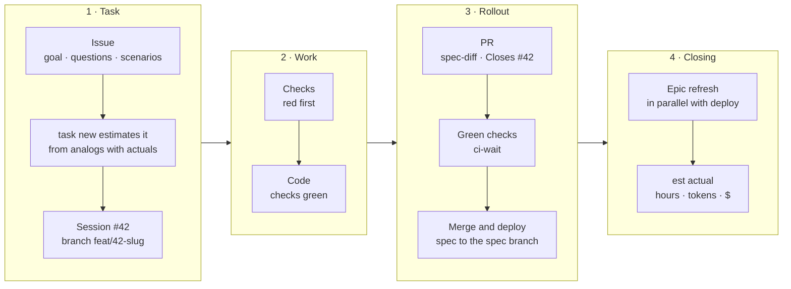

<div align="center">

# Elves

*Elves at work*

**A development flow for AI agents: deterministic checks instead of prose specs.**

Claude Code · Codex · Gemini CLI · Cursor · Copilot · OpenCode · Amp

[](https://github.com/miroshnik/elves/actions/workflows/ci.yml)
[](https://github.com/miroshnik/elves/releases)
[](https://agentskills.io)
[](https://github.com/miroshnik/elves/tree/spec)

[The idea](#the-idea) · [Why](#why) · [Elves and OpenSpec](#elves-and-openspec) · [Installation](#installation) · [Skills](#skills) · [Layout](#repository-layout)

</div>

---

## What it is

Elves is how an agent carries a task from issue to production, written down once for all agents and all projects:

- **The canon** [`AGENTS.md`](AGENTS.md) — the rules: tasks and estimates, branches and PRs, merging and CI, the specification, production.
- **Skills** following the open [Agent Skills](https://agentskills.io) standard — a prompt plus a script for everything deterministic: the GitHub project, estimates from actuals, the spec from tests, waiting for CI.
- **The installer** — puts the canon, the skills and the hook onto the machine, for all agents at once; a project keeps only the package version in `devDependencies` — CI, colleagues and the cloud session get it from npm — and gets the flow through releases.

One task — from issue to actual:



## The idea

Developing any software is making decisions, of two kinds:

- **functional** — what the system does: what it stores and for how long (an order — for good, a cart — for the session), what it shows and to whom;
- **non-functional** — what it's made of and which rules it obeys: data in Postgres, every input form has a reset button, search answers in under 300 ms.

Every decision has a **deterministic check** — run by the machine, not judged by a person or an agent — that the decision holds. A decision without a check is a wish: nothing tells when the code stops following it, and a prose spec is a list of such wishes. So the code answers what the system does and how it is built now, and the checks — what it should do and how it should be built: they are its specification.

A check is written before the code and fails — the decision isn't implemented yet: that's its acceptance test. The code makes it pass, and from then on the check holds the decision against every later change: that's its regression test. A decision changes the same way — its check first, red on the current code, then the code follows it to green. A check that can't fail holds nothing: a regression test is proven by reverting the fix and seeing red.

| Decision | Kind | Check | Lives in |
|---|---|---|---|
| An order survives a restart | functional | an integration test | `tests/capabilities/orders/persistence` |
| Search answers in under 300 ms | non-functional, a quality of one capability | a load test with the budget | `tests/capabilities/search/latency` |
| Every input form has a reset button | non-functional, a standard | "registry + invariant": a test per form from the code | `tests/standards/forms/reset-button` |
| Data is stored in Postgres | non-functional, architecture | the model: a module importing another driver — red | `tests/architecture/model.ts` |

A decision is a **topic with sections**: the topic is the subject (`orders`, `forms`) — a product area as the user names it, or the kind of element a rule applies to; a section is one statement about it (`reset-button`), with its reason in `<section>.md` and its checks in `<section>.test.ts`. A new rule goes in as a section of the topic whose subject covers it, not as a new folder. Decision labels on GitHub tasks name the topic and show its kind by color — 🟩 a capability, 🟦 a standard, 🟧 architecture; how each check is wired — the [`spec`](skills/spec/SKILL.md) skill.

## Why

An agent writes code fast; everything around the code is what becomes slow and expensive. Each row is a section of the canon, [`AGENTS.md`](AGENTS.md).

| Without the flow | With Elves | Canon |
|---|---|---|
| Knowledge lives in the chat and the agent's memory; the next session starts from scratch | Agreed — in the issue: the goal, `## Questions` with answers, `## Scenarios` — future test names; every fact has one home; before a pause — a State comment | [Task tracking](AGENTS.md#task-tracking) · [Project knowledge and handoff](AGENTS.md#project-knowledge-and-handoff) |
| Rules-as-text go stale silently; a green test may catch nothing | Every decision is held by a deterministic check; a test failed — its root cause is fixed, not a retry added | [Specification — decisions](AGENTS.md#specification--decisions) · [Tests and code](AGENTS.md#tests-and-code) |
| Work isn't linked to a task | Session = task = branch = PR (`#42 …`, `feat/42-slug`, `Closes #42`); a second task — to Backlog and, on a "yes", to a background executor | [Session and branch](AGENTS.md#session-and-branch--one-task) |
| Estimates are guesses | From analogs with a measured actual: active hours, tokens and $ from the agent's transcripts | [Estimate and actual](AGENTS.md#estimate-and-actual--the-est-skill) |
| The agent merges on its own — or asks about everything | Reversible — on its own, irreversible — on an explicit "yes"; `auto` runs a task by itself, up to merging its own PR on green checks | [What I do without asking](AGENTS.md#what-i-do-without-asking-and-what-needs-a-yes) |
| PRs wait in a merge queue | Each PR merges on its own green checks; `main` moved after its CI — fast checks on the merge first; after a deploy — its statuses | [Git, PRs and merging](AGENTS.md#git-prs-and-merging) |
| Each project has its own process, and the agent improvises its routine | One canon for all projects and agents, a script for everything deterministic; a project pins the version, a session first checks the flow is up to date | [This file and skills](AGENTS.md#this-file-and-skills) · [First step of a session](AGENTS.md#first-step-of-a-session--an-up-to-date-flow) |

## Elves and OpenSpec

[OpenSpec](https://github.com/Fission-AI/OpenSpec) is a popular spec-driven framework: requirements in Markdown (`SHALL`, `WHEN` / `THEN` scenarios), every change is a folder in `openspec/changes/` with `proposal.md`, `tasks.md`, `design.md` and spec deltas merged into `openspec/specs/` after rollout. Elves used to run on top of OpenSpec; now it replaces it entirely.

| | OpenSpec | Elves |
|---|---|---|
| **Where a requirement lives** | `openspec/specs/<capability>/spec.md` — prose | `tests/capabilities/<capability>/` — `describe` is the requirement, `it` a scenario; it runs |
| **What keeps the spec true** | the agent's discipline; `validate` checks structure, not truth | CI: behavior changed without a test — red |
| **Agreement before code** | `proposal.md`, `tasks.md` | the issue: `## Questions` and `## Scenarios` — future test names |
| **A change in the PR** | ADDED / MODIFIED / REMOVED deltas — separate files written by the agent | `spec-diff` from git: added, changed and removed requirements |
| **Documentation** | the specs themselves — read them whole | generated from test names into the `spec` branch after merge, not into `main` |

**What a live project showed.** A product project on OpenSpec — 68 specs, ≈1000 requirements, 3 MB of Markdown — with `openspec validate --strict` green: 6 of 11 requirements checked were stale, and in a measured task ≈26% of what the agent read was OpenSpec artifacts. Its 1052 requirements moved into tests in 13 PRs: only 56% had a test; check by breaking found at least 165 tests that counted as coverage but didn't catch the breakage, and 70 bugs turned up along the way. How to migrate — [`skills/spec/migration.md`](skills/spec/migration.md). The spec format isn't the main token cost, though: subagents and what they are told to read cost more.

**When OpenSpec fits better:** you need a requirements document for people outside the code; the project has no tests and won't have them; you need a "proposal before code" gate as a separate artifact. Elves moves this gate into the issue — scenarios are visible before code — but not into a file.

## Installation

You need `git` and [Bun](https://bun.sh) ≥ 1.2; the `github`, `est` and `dashboard` skills also need [`gh`](https://cli.github.com) with the `project` scope, `task-env` — Docker with Compose.

```bash
bunx @miroshnik/elves install -g   # onto the machine: the canon, the skills and the hook for every agent it has
bunx @miroshnik/elves install      # into a project, from its git root: the package version and the manifest, committed with it
bunx @miroshnik/elves check -g     # is the flow behind the latest release: 0 — no, 1 — yes, 2 — can't check; changes nothing
bunx @miroshnik/elves update -g    # bring it to the latest release
```

Without `-g` — the same for the project. `install` in a project asks whether the agent runs a task entirely by itself, up to merging its own PR on green checks (`auto`, no by default), and which language it works in; in Claude Code the `SessionStart` hook puts the `check` output at the start of every session. The flow follows releases — date tags that `elves release` cuts as the owner's step and CI publishes to npm with `elves pack <tag>`. In a project the skills' scripts run at its package version, as `bun --no-env-file node_modules/.bin/elves <script>`: `elves spec-doc`, `elves spec-diff`, `elves spec-publish`, `elves spec-run`, `elves spec-shard`, `elves spec-claims`, `elves spec-break`, `elves precommit`, `elves slot`, `elves task-env up`, `elves task-env e2e`, `elves task-env down`, `elves task-env prune`, `elves task-env check`, `elves task-env proxy up`, `elves task-env proxy down`, `elves task-env proxy status`.

What goes where, the agent's sandbox, the mode and the language, releases, the package in a project and working from a clone — [`docs/installation.md`](docs/installation.md).

## Skills

Installed onto the machine with the flow; the agent picks a skill up by itself from its `SKILL.md`, which has the details.

### [`github`](skills/github/SKILL.md) — project and tasks by the canon

The GitHub project and tasks, a command per step: a task with its fields and estimate, its questions and answers, its tail from branch to close — PR, CI, merge, deploy, epic refresh — and a dispatcher's queue of background executors.

`github project check` · `github project fix` · `github task new | show | answer | edit | start | status | drop | actualize | close | finish | resume | queue` · `github batch release` · `github pr labels | premerge`

### [`est`](skills/est/SKILL.md) — estimates from actuals

An estimate from analogs with a measured actual, set by `github task new` itself; the actual — active hours, tokens and the API equivalent in $ from Claude Code, Codex and cloud session transcripts.

`est estimate` · `est fact` · `est history` · `est backtest` · `est period` · `est cloud-import`

### [`dashboard`](skills/dashboard/SKILL.md) — sessions at work, estimate, actual and cost

A browser page: sessions at work and what each waits for — CI, merge, deploy, a human's answer — with the owner's open questions; estimate against actual, tokens and cost by task close date.

`dashboard [--repo o/r | --all-repos] [--since 90d]`

### [`spec`](skills/spec/SKILL.md) — specification from tests

The spec from tests: documentation from runner reports into the `spec` branch, the PR's requirement diff, CI shards, entry points called by tests, check by breaking, the checks before a commit and the harness of deterministic checks.

`spec-doc` · `spec-diff` · `spec-publish` · `spec-run` · `spec-shard` · `spec-claims` · `spec-break` · `precommit` · `harness.ts`

### [`ci-wait`](skills/ci-wait/SKILL.md) — wait for checks, don't guess

Waits for all checks of a PR or a commit — CI, deploy, an external check — with progress and PASS / FAIL / TIMEOUT / ERROR outcomes instead of `gh pr checks --watch` and `sleep` in a loop.

`wait-ci pr | status | merged | issue`

### [`slot`](skills/slot/SKILL.md) — the machine's heavy runs in a queue

Project checks and task stacks wait in the machine queue: as many runs at a time as the machine has slots, the rest in arrival order; the runner takes its workers from `ELVES_SLOT_CPUS`.

`slot '<command>' [args…]` · in `package.json`: `. .agents/slot.sh && <command>`

### [`task-env`](skills/task-env/SKILL.md) — a task's environment: its Compose stack and addresses `*.localhost`

A task's own Docker Compose stack `<project>-<N>` with addresses `http://<service>.<N>.<project>.localhost` through one Traefik proxy per machine — no host ports, separate cookies, parallel sessions don't touch each other; `check` holds the compose file to the isolation rules.

`task-env up | e2e | down | prune` · `task-env proxy up | down | status` · `task-env check [<dir>]`

### References

Mechanics the canon refers to; the agent reads them as needed.

- [`docs/installation.md`](docs/installation.md) — what goes into a project and onto the machine, the session hook and the sandbox, the mode and the language, releases, the package in a project, working from a clone.
- [`docs/pr-checks.md`](docs/pr-checks.md) — waiting for PR, commit and deploy checks; the app's Auto-fix is off: a conflict is a rebase.
- [`docs/ci-concurrency.md`](docs/ci-concurrency.md) — CI for parallel tasks: parallel branches, a non-cancellable `main`, a deploy queue.
- [`docs/testing.md`](docs/testing.md) — what runs before a commit and what in CI, a run's result by the runner's summary, e2e without flakes, UI state by the DOM.
- [`docs/judgment.md`](docs/judgment.md) — judgment and edits: a mistake disguised as an outcome, a label is a claim, editing exactly what was named.
- [`docs/production.md`](docs/production.md) — production: migrations, the right database, "didn't help" goes to production facts.
- [`docs/parallel-checkouts.md`](docs/parallel-checkouts.md) — parallel worktrees: shared files, ports, databases and `.git/config`.
- [`docs/cloud-sessions.md`](docs/cloud-sessions.md) — the Claude Code cloud session: what it can't access, its brief, closing a task from there.
- [`docs/prompt-cache.md`](docs/prompt-cache.md) — Claude Code's prompt cache TTL: 5 minutes or the hour, and when the hour pays off.

## Repository layout

```
AGENTS.md          the canon of rules — for all agents
claude/CLAUDE.md   only what Claude Code has
docs/              references the canon links to
skills/<name>/     SKILL.md + scripts/ — TypeScript under Bun, no dependencies
tests/             Elves' own spec: capabilities/ and standards/
bin/elves.ts       the installer — TypeScript under Bun too: bunx runs it from node_modules by its shebang
bin/shims/         commands the SessionStart hook adds to the end of the agent's Bash PATH: timeout
```

**A skill = a prompt + scripts** following the open [Agent Skills](https://agentskills.io) standard: a `<name>/` folder with `SKILL.md` — when and what to call — and `scripts/` for the deterministic part, TypeScript under Bun (`bun script.ts`: no build, no dependencies, imports with `.ts`); reference material — `reference.md` and the scripts' `--help`. Third-party code a script can't do without goes into `scripts/vendor/` as a file with its license, not as a dependency. Everything that depends on specific repositories goes into local configuration, not into the skill.

Elves lives by its own flow: the spec — [`tests/`](tests), its documentation — in the [`spec` branch](https://github.com/miroshnik/elves/tree/spec), tasks — in [Issues](https://github.com/miroshnik/elves/issues) and the [elves project](https://github.com/users/miroshnik/projects/6).

The spec is read from the branch, not from the working tree — the same in any project with the flow:

```bash
git fetch origin spec
git show origin/spec:README.md                 # table of contents: capabilities, architecture, standards
git show origin/spec:capabilities/est.md       # a decision page: why, what holds, what checks it
```

```bash
bun install
bun run test:spec     # Elves standards — tests/standards, once: test doesn't repeat them
bun run test          # fast level: script tests without standards, Docker and live servers
bun run test --changed=origin/main   # before a commit — what the change affects; a changed script — its tests by path; in full — CI
bun run test:slow     # slow level — *.slow.test.ts: Docker, live servers; CI runs both levels
bun run typecheck     # bun check — Bun's own type checker, Bun 1.4.3 from packageManager
bun run spec:doc      # docs/spec from test names, --strict
```

The README is part of the flow too: a new skill, command, script subcommand or reference without a line here fails `bun test`, and so does a link to a renamed canon section ([`tests/standards/documents/readme`](tests/standards/documents/readme.md)).
